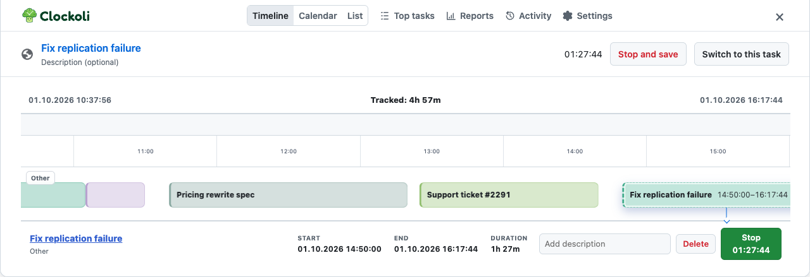
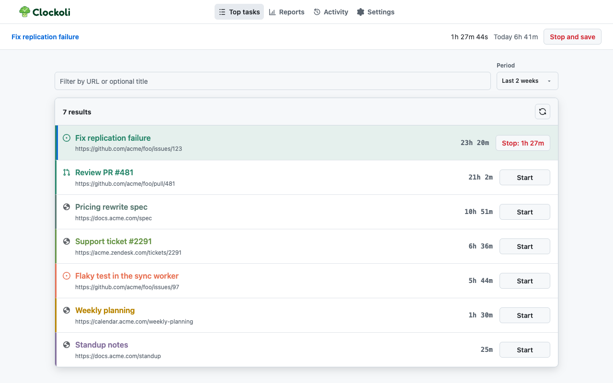
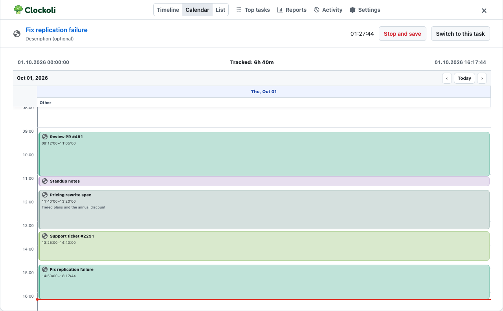
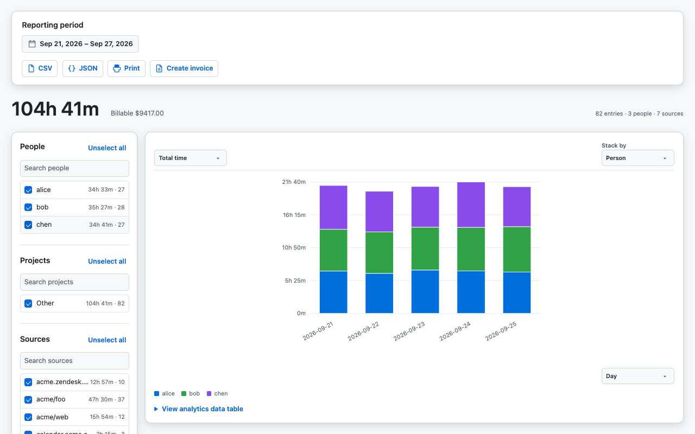

<p align="center">
  
</p>

<h1 align="center">Clockoli</h1>

<p align="center">
  <strong>Time tracking that lives in your GitHub repo.</strong><br>
  A browser extension that tracks time on any task URL and writes readable records to private GitHub repositories you control. There is no Clockoli server.
</p>

<p align="center">
  <a href="https://chromewebstore.google.com/detail/clockoli/omkikhlcnbjpfbiicogjekhjgmbajmnl"></a>
  <a href="https://github.com/clockoli/clockoli/actions/workflows/ci.yml"></a>
</p>

<p align="center">
  <a href="https://clockoli.com/">Website</a> ·
  <a href="#install">Install</a> ·
  <a href="docs/getting-started.md">Getting started</a> ·
  <a href="docs/README.md">Documentation</a> ·
  <a href="CHANGELOG.md">Changelog</a> ·
  <a href="https://clockoli.com/extension-privacy/">Privacy policy</a>
</p>

<p align="center">
  
</p>

## Why Clockoli

Most time trackers keep your hours in a vendor database. Clockoli writes them to Git instead:

- **Your data stays in your repository.** Hours go to a private GitHub repository you choose, so you decide who can read them, how long they are kept and when they are deleted.
- **Back up everything with one command.** `git clone` copies every entry you have tracked. Each completed entry is one line of JSON in a monthly file, in a [documented format](docs/data-format-v1.md), so the copy stays readable without Clockoli.
- **Ask an AI where the time went.** Point an AI agent at the clone and ask which tasks ran over or how many hours to bill this month. No export step, no Clockoli API.
- **See every change, and undo it.** Each synchronized edit or deletion is a Git commit, so `git log` shows what changed and when, and an earlier version can be restored from history. Several edits made before a sync arrive as one commit.
- **No Clockoli account or server.** The extension talks directly to GitHub. There is nothing to sign up for, and your GitHub credentials stay in the extension.
- **Your rates stay in your browser.** Reports, billable amounts and invoices are calculated locally. Hourly rates and invoice details live only in browser storage: they are never written to the time repository, so teammates who share it never see them, and no tracker server holds them. The only copy outside the browser is a settings backup file you export yourself. Mixed-currency reports send only currency codes and dates to the [Frankfurter](https://frankfurter.dev/) exchange-rate service.
- **Any URL is a task.** GitHub issues and pull requests, documents, support tickets, dashboards: the page address is the task identity, and a title is optional.

Clockoli fits teams that already work in GitHub and care more about owning and auditing their data than about one-click SaaS onboarding. [Why Clockoli](docs/why-clockoli.md) explains the tradeoffs, and [clockoli.com](https://clockoli.com/#compare) compares it with Toggl Track, Clockify, Harvest, Kimai and solidtime.

## Install

**Chrome and other Chromium browsers (102+):** [add Clockoli from the Chrome Web Store](https://chromewebstore.google.com/detail/clockoli/omkikhlcnbjpfbiicogjekhjgmbajmnl). It updates automatically.

<details>
<summary><strong>Firefox (140+) and Safari (18+, macOS) preview</strong>: manual install from a GitHub release</summary>

<br>

Firefox and Safari builds are still in testing. They are not listed on addons.mozilla.org or the Mac App Store, so these installs do not update automatically.

**Firefox**

1. Download `Clockoli-X.Y.Z-firefox-signed.xpi` from a [GitHub release](https://github.com/clockoli/clockoli/releases).
2. Open `about:addons`, choose the gear menu → **Install Add-on From File**, and select the file.

A release without a signed XPI can only be loaded temporarily, from `about:debugging#/runtime/this-firefox`.

**Safari**

1. Download `Clockoli-X.Y.Z-safari-extension.zip` from a [GitHub release](https://github.com/clockoli/clockoli/releases) and extract it.
2. In Safari Settings → Advanced, turn on **Show features for web developers**.
3. In Safari Settings → Developer, choose **Add Temporary Extension…** and select the extracted folder.

Safari removes temporary extensions after 24 hours or when you quit Safari; add the folder again to keep using Clockoli. A signed Safari app will remove this step.

</details>

Store reviews can make the Chrome Web Store version trail the latest GitHub release. [Getting started](docs/getting-started.md#1-install-clockoli) covers every install path, including loading this repository unpacked for development.

## Quick start

1. **Sign in with GitHub.** Open **Settings**; it opens by itself after installation. Clockoli uses GitHub [device flow](https://docs.github.com/en/apps/oauth-apps/building-oauth-apps/authorizing-oauth-apps#device-flow): you enter a one-time code on github.com and approve access, so you never create or paste a token. If your browser asks for access to GitHub, allow it.
2. **Connect a private time repository.** Paste a repository URL or `owner/name`, or create a new one from the Clockoli template, then confirm **Connect repository**.
3. **Track a task.** On a GitHub issue or pull request, use the stopwatch next to your avatar. On any other page, click the Clockoli toolbar button and choose **Track this task**. Choose **Stop and save** when you finish.

Your GitHub account signs you in, a source repository may own the issue you track, and a time repository stores your records. These can all be different. The [setup guide](docs/getting-started.md) explains repository access.

## Features

### Track

- Start a timer on any HTTP(S) page from the toolbar, or from the stopwatch built into GitHub issue and pull-request pages.
- Keep one running timer: starting another task stops the current one first. Timer changes are queued locally and synchronized with GitHub, so they survive going offline.
- See live **Today** and **This week** totals, and switch to a recent task from **Top tasks**.

<p align="center">
  
</p>

### Correct

- Edit entries in a timeline, calendar or list. Drag and resize blocks; moving an entry into its neighbour adjusts the neighbour in the same commit.
- Delete entries, add completed entries in bulk on the Activity page, and merge task identities that refer to the same work.

<p align="center">
  
</p>

### Report and bill

- Report across personal and organization time repositories, with breakdowns by day, week, month, person, source or task.
- Export CSV or JSON timesheets, or print a report to PDF.
- Set effective-dated hourly rates per person. Rates stay in your browser and are never written to the repository; mixed currencies are converted at each day's exchange rate.
- Create numbered, taxed invoices from a filtered report and print them or save them as PDF. Invoices are generated in the browser and never committed.

<p align="center">
  
</p>

### Work as a team

- Teammates track into the same private repository, each on a personal branch, and Reports reads them as one view.
- If you administer a time repository, invite teammates to it from Settings.
- Import Clockify history with the optional [Clockify add-on](docs/add-ons.md), with a preview and explicit mapping of Clockify users to GitHub users.

The [feature guide](docs/features.md) describes every behavior in detail.

## Your data and permissions

Each completed entry is one JSON line in `times/{YYYY-MM}/{login}.jsonl`; a running timer lives in its own file under `active/`. The [data format](docs/data-format-v1.md) is versioned (`schema_version` 1).

Clockoli sends data only to GitHub, plus currency codes and dates to the [Frankfurter](https://frankfurter.dev/) exchange-rate service when a report converts currencies. It contains no analytics.

| Access | Why |
|---|---|
| `api.github.com` | Read and write time records in the repositories you connect; read titles of issues and pull requests you track. |
| `github.com/login` | GitHub device-flow sign-in. |
| `github.com/*` (content script) | Show the stopwatch and tracker panel on GitHub pages. |
| `api.frankfurter.dev` | Historical exchange rates for mixed-currency reports. |
| `activeTab`, `scripting` | Read the current tab's URL and title and show the tracker panel when you click the toolbar button. |
| `alarms` | Retry queued writes to GitHub once a minute. |
| `favicon` (Chrome only) | Show each task's site icon. |
| `app.clockify.me` (optional) | Requested only when you enable the Clockify import add-on. |

Anyone who can read a time repository can read the URLs, titles, timestamps and descriptions in it. See [Data, privacy, and security](docs/data-and-privacy.md) for the full storage model.

## Current limitations

- Chrome and other Chromium browsers are the supported platform. Firefox and Safari builds are still in testing and update manually.
- There is no mobile app, no reminders and no side-by-side conflict editor. Unresolved sync conflicts can need your action.
- Everyone who tracks time needs a GitHub account. GitHub outages and API rate limits affect Clockoli.
- Git history makes edits visible, but repository administrators can rewrite it. It is not a tamper-proof audit log.

## Documentation

- [Getting started](docs/getting-started.md)
- [Feature guide](docs/features.md)
- [Why Clockoli](docs/why-clockoli.md)
- [Data, privacy, and security](docs/data-and-privacy.md)
- [Time-data repository setup](docs/time-data-repository.md)
- [Packaged add-ons](docs/add-ons.md)
- [Troubleshooting](docs/troubleshooting.md)
- [Browser release support](docs/browser-releases.md)

## Development

Requires Node.js 20.19+ (CI uses Node.js 22) and Python 3 for release packaging. The extension has no runtime package dependencies; the timeline component and test tooling live in this repository as an npm workspace.

```bash
npm ci
npm test
npm run check
```

Load the repository root as an unpacked extension in `chrome://extensions` with **Developer mode** on. [CONTRIBUTING.md](CONTRIBUTING.md) covers architecture rules, browser verification and release packaging for Chrome, Firefox and Safari.

## Support and security

- Report bugs and request features in [GitHub Issues](https://github.com/clockoli/clockoli/issues).
- Report security vulnerabilities privately as described in [SECURITY.md](SECURITY.md).
- For anything else, email [contact@clockoli.com](mailto:contact@clockoli.com).
