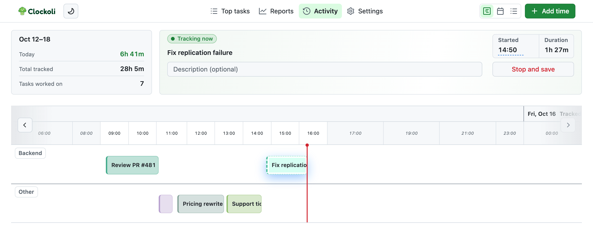
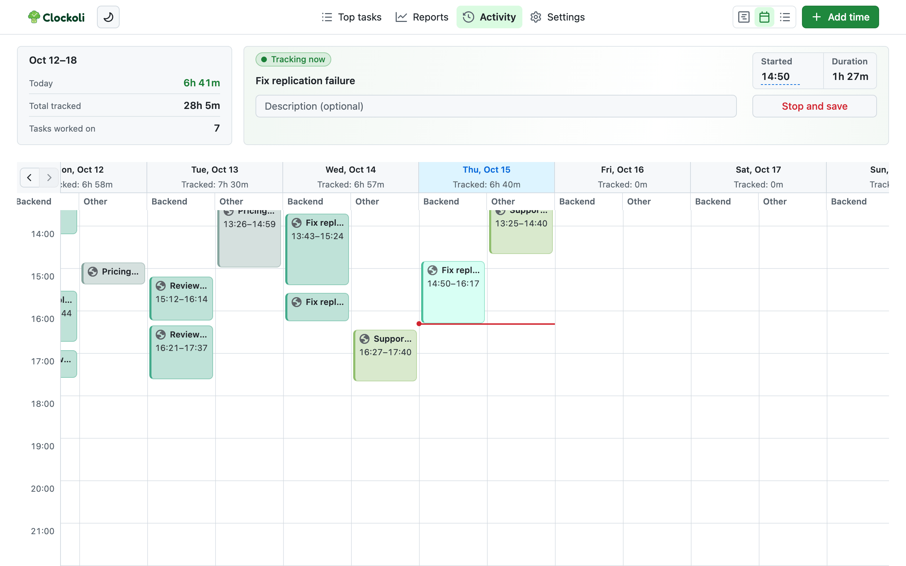
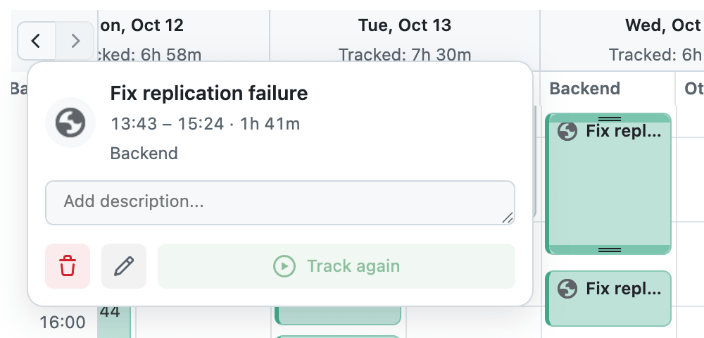
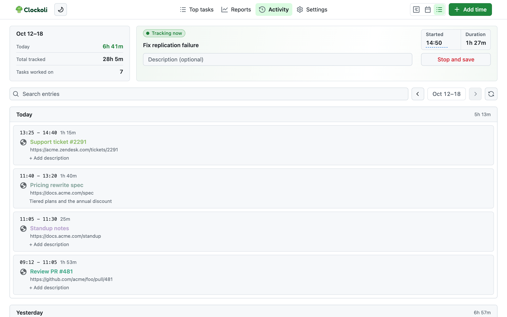

# Activity

Use Activity to review tracked time, correct entries, and search your history. It shows one Monday–Sunday week in **Timeline**, **Calendar**, or **List**.

## Open Activity

Select the Clockoli toolbar icon on any page, or the Clockoli stopwatch on GitHub. By default, Clockoli opens Activity in a new tab or focuses an existing Activity tab.

When you open it from an HTTP(S) page, the **From current page** banner lets you track that page. You can instead select **Open quick popup** under [Settings → Toolbar button](settings.md#toolbar-button). The popup always includes **Open Activity in a new tab**.

## Browse weeks

Use the arrows to move between weeks. The next-week arrow is disabled when the current week is displayed.

Clockoli remembers your selected view. Switching between Timeline, Calendar, and List returns to the current week; navigating within a view keeps the week you chose.

The summary shows:

- **Today:** time tracked on the current local day, even if you are viewing a different week.
- **Total tracked:** time in the selected week.
- **Tasks worked on:** distinct tasks in that week.

Pending local changes appear in Activity before they reach GitHub. Reports uses committed GitHub data instead; see [Sync and offline work](sync.md).

## Timeline and Calendar

Both views display time entries, including work that crosses midnight. An interval contributes time to each day it touches. The running timer appears in the current week.

- **Timeline** supports horizontal browsing and zoom. Moving or resizing an entry snaps to **five-minute increments**.
- **Calendar** shows each day against an hourly grid, with **one-minute precision** when moving or resizing.
- Both views display the exact stored duration rounded to minutes, and keep zero-duration entries visible without adding to the totals.
- An empty day shows **No time entries**.

### Select an entry

Hover over, focus, or tap an entry to see its details. Selecting a completed entry lets you:

- **Track again:** start a new timer for the same task.
- **Edit:** open the entry's time-editing form.
- **Delete:** remove the entry after confirmation.
- **Add description...:** edit its note directly, including when it was previously empty.

**Enter** saves an inline description, **Shift+Enter** adds a line, and **Escape** cancels an unsaved change. Leaving the description field also saves it.

Only the actual **running entry** offers **Stop and save**. A completed entry for the same task cannot stop the active timer; its **Track again** action is unavailable while that task is already running.

### Move and resize entries

Drag a completed block to move it or drag its edges to change its Start or End. Clockoli finds an available position and checks for overlaps before accepting the edit.

- Moving an entry keeps its duration. Other entries stay in place unless you make an explicit linked correction in List.
- Moves stay within the displayed week. An entry crossing the week's boundary cannot be dragged from its clipped block.
- Edits cannot place completed time in the future.
- Moving and resizing are unavailable until the selected week loads completely.

If an edit is rejected, the original entry remains unchanged and Activity explains why. See [Overlap checks](editing-time.md#overlap-checks).

## List

List groups the selected week's entries by date and offers direct time editing, task links, descriptions, and start/stop actions.

Edit an entry's Start or End directly, then select **Save time**. You can also edit its URL, title, and description or select **Delete**. Some changes to adjacent entries are linked; see [Correct times inline](editing-time.md#correct-times-inline).

### Search all history

Enter a title or URL in **Search activity** to find completed entries across available weeks and connected time repositories, not just the displayed week. Results appear newest first, up to **20 per page**. Clear the search to return to the selected week.

The first search may load older history. If a repository cannot be read, Activity warns about incomplete results instead of saying no matches were found.

## Loading, overlaps, and sync issues

Activity loads the selected week from GitHub while keeping locally accepted changes visible. An incomplete read can disable editing, and a failed read offers **Retry**.

Overlapping entries may prevent Timeline or Calendar from displaying a week. Use **Go to List** to inspect and correct the affected entries; do not treat an empty-looking view as evidence that records were deleted.

When synchronization needs attention, open **Review sync issues** in Activity. See [Troubleshooting](troubleshooting.md#synchronization-and-conflicts).
