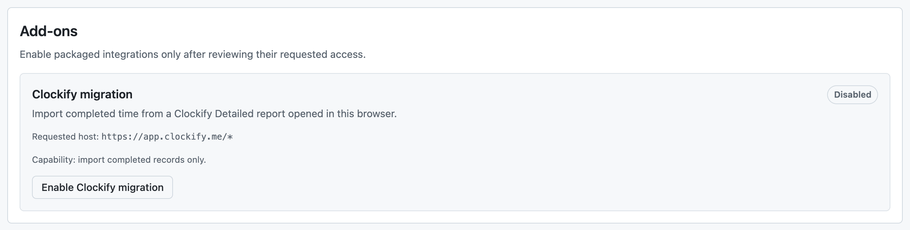

# Add-ons and Clockify migration

Clockoli includes packaged add-ons. The Clockify migration add-on can bring completed time records into your own GitHub time repository.

## Enable an add-on

Open **Settings → Add-ons**, review the integration's requested access, and select **Enable**. Add-ons ship with the extension; Clockoli does not download remote executable plugins.

Disabling an add-on removes its optional access but **does not delete** records already imported into Clockoli.

## Clockify migration

The migration reads reports from a Clockify tab where **you are already signed in**. Clockoli does not ask for or store your Clockify password or API token.

### Import your history

1. In **Settings → Add-ons**, select **Enable Clockify migration** and grant access to `https://app.clockify.me/*`.
2. Open Clockify's **Detailed Report** in a signed-in tab. Reload the tab if it was already open.
3. Use the Clockoli banner on that page. Start with **CSV migration**, or choose **Page to page migration** if CSV export is unavailable.
4. Wait for the report capture and review the preview's dates, people, and entry counts.
5. Map each Clockify person you want to import to a GitHub account. Leave **Skip this person** selected for anyone you want to exclude.
6. Select **Import completed time** and review the result for each person.

The CSV option captures Clockify's own report exports; Page to page reads completed Detailed Report pages. Both are started from the open Clockify tab. There is no separate CSV-upload step.

If Clockify repeatedly offers to email a report instead of downloading CSV, Clockoli suggests Page to page migration. An incomplete year does not produce a misleading finished preview.

### Where imported time goes

Imported records are written to the selected GitHub users' personal branches in the connected default time repository. Clockoli verifies each account before writing. Importing time does not automatically invite that account to the repository.

A person who is not yet a collaborator can be mapped, but repository access may need to be granted separately. Clockoli may offer a follow-up invitation after a successful import; it never sends one without confirmation.

Clockoli does not invent GitHub URLs for imported tasks. Tasks without URLs receive a non-clickable `owner/project/task-slug` identity. To connect one to a real issue or page later, use [Settings → Merge tasks](settings.md#merge-tasks).

If an imported interval overlaps existing time, Clockoli moves it forward to a free interval without shortening its duration. It also checks for prior imports to avoid duplicating the same work.

### Preview, progress, and privacy

The preview expires after **one hour**. Import starts only after you confirm the user mappings. The add-on keeps enough local state to report an interrupted import's progress after a browser-worker restart; do not clear extension data while an import is pending.

Each person's outcome shows whether time was **Imported**, **Already present**, or could not be imported. Review the result before assuming migration is complete.

Clockoli captures only the report data needed for migration, not Clockify cookies, authentication headers, or API tokens. The privileged extension core validates imported records and writes to GitHub; the Clockify page cannot directly access Clockoli's GitHub credentials.

For missing controls, unavailable exports, rate limits, or interrupted imports, see [Clockify migration troubleshooting](troubleshooting.md#clockify-migration). For the storage format, see [Data format v1](data-format-v1.md).
