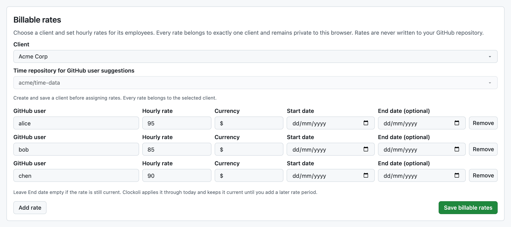

# Billable rates

Each hourly rate belongs to a **client**. There are no global or shared default rates.

Rates, clients, and invoice settings stay in your browser and in settings backups you choose to export. They are **not written to GitHub**.

## Set up a client's rates

1. In **Settings → Clients (invoice recipients)**, create and **Save** a client. Invoice contact details are optional if you only need reports.
2. Open **Billable rates** and choose that client.
3. Choose a connected time repository to suggest GitHub collaborators, then select or type each person's GitHub login.
4. Enter their hourly rate, currency, and optional effective dates. Select **Save billable rates**.
5. Repeat for other clients, if needed.

The repository selector only changes collaborator suggestions. It does not limit which time a client's rate can evaluate.

Effective dates are inclusive. The same person can have different rates for different clients or different periods. If no rate covers an entry, the amount is **Unrated**; Clockoli never borrows a rate from another client.

## Use rates in Reports

In **Reports**, filter by Client if needed and choose **Calculate amounts using**:

- **Each project's client** applies the rate card of the client assigned to the entry's project.
- A **specific client** applies that client's rates to all visible work, which can help when reporting on a team's work across projects.

Unrated entries contribute no calculated amount. Different currencies are kept separate unless you select a conversion currency. Clockoli sends only currency codes and dates to Frankfurter when conversion is needed.

## Use rates on invoices

When creating an invoice, choose its client. Clockoli always applies **that client's rates**. If you included a project belonging to another client, review the warning before issuing the invoice.

## Privacy and backups

Teammates sharing a time repository do not share rates or calculated billable amounts. Each browser can have a different rate card for the same entries.

After changing rates, [export your settings](settings.md#backup--restore) and protect the file. It may contain sensitive rates, client information, and bank details.
