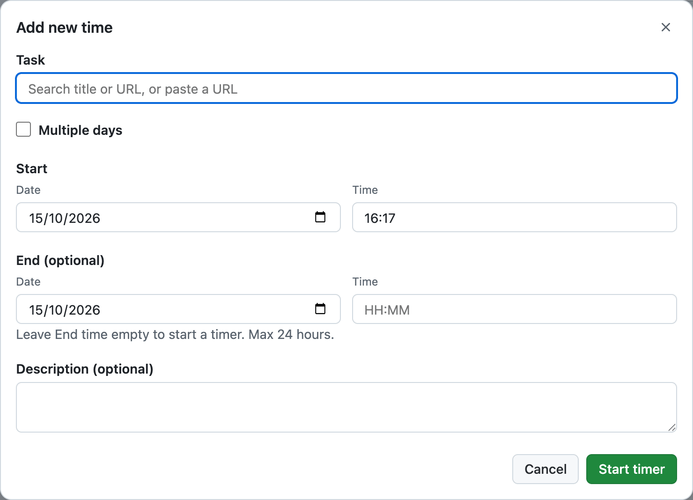
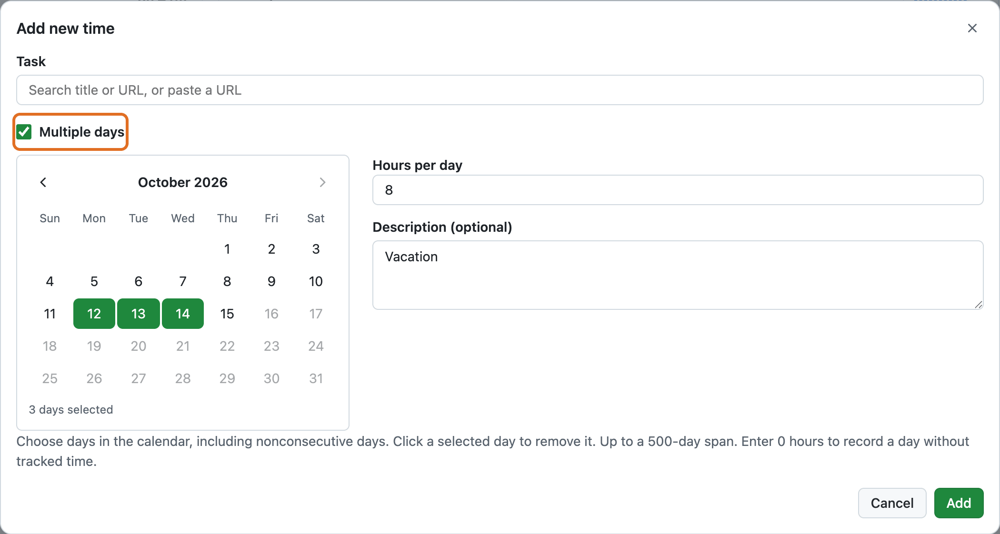
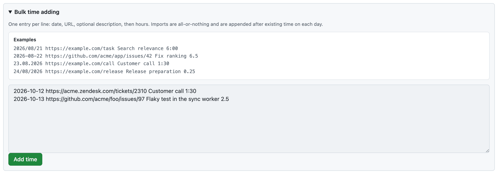
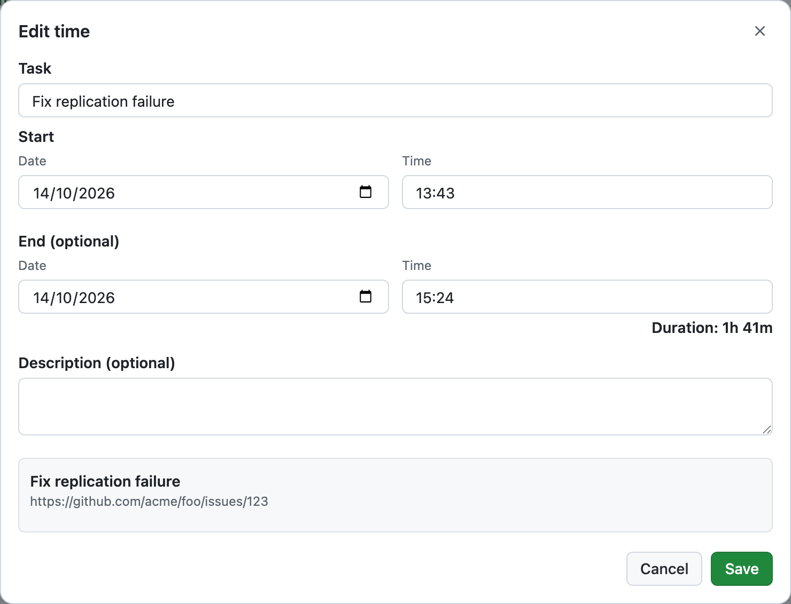

# Add and edit time

Add work you forgot to track, correct time entries, or change when a running timer started.

New entries are saved in your browser immediately and synchronized with GitHub in the background. Edits that require a fresh overlap check may need GitHub access.

## Add a single entry

Select **Add time** in Activity or Top tasks.

1. Find a tracked task by title or URL, or paste a new HTTP(S) URL.
2. Choose the **Start** date and time.
3. To add completed time, enter an **End** date and time. To start a timer instead, leave End time empty.
4. Optionally enter a description, then select **Add time** or **Start timer**.

The Start and End dates have separate calendars; you can select the End date before entering its time. If you enter an End time earlier than Start and have not chosen an End date explicitly, Clockoli assumes the next day.

A completed entry can be at most **24 hours**. Future times are not allowed. For a new timer, an explicitly entered past Start cannot be more than 24 hours old. An existing running timer is not stopped automatically after 24 hours.

If you leave End empty and have not changed the default Start, Clockoli starts at the current moment, including seconds. Editing Start deliberately uses the selected minute.

### Multiple days (for time off)

Select **Multiple days** to add the same amount of time on several dates.

1. Choose the task and select days in the calendar, including nonconsecutive days.
2. Enter **Hours per day** (0–24) and an optional description.
3. Select **Add**.

Dates must fit within a **500-day span** and cannot be in the future. Enter `0` explicitly if you want zero-duration entries.

Clockoli tries to place each interval at 09:00 local time. If that slot is occupied, it finds another continuous free interval on the same day. A 24-hour interval can extend into the following day.

**The batch is all or nothing:** if a selected day cannot fit the requested hours, nothing is added. Changes accepted locally can still need adjustment or conflict review if GitHub contains time that was not in this browser's cache. See [Sync and offline work](sync.md).

### Search for a task

Clockoli maintains a local catalog of tracked tasks from connected repositories. Search by title or URL normally uses that catalog without a GitHub request. A first search on a new device or an outdated catalog may refresh it.

Search suggestions include valid HTTP(S) tasks with nonempty titles. Untitled URLs can still be pasted directly. Imported Clockify tasks without URLs are not suggested for new entries, but existing imported entries remain editable and can be restarted from Top tasks.

If GitHub cannot be reached or a repository cannot be read, search may show partial results. An already-entered valid URL remains usable.

## Add many entries at once

On **Activity**, expand **Bulk time adding**. Enter one dated task URL per line, with its duration and optional description. The examples above the editor show the accepted format.

Clockoli finds a continuous free slot for each entry. It normally places new time after existing work on that day, then looks for an earlier free slot if necessary.

The entire batch is accepted into local storage together and appears in Activity immediately. GitHub syncs it later. If there is not enough space, Clockoli keeps the draft and shows an error rather than partially adding the batch.

## Edit a completed entry

Select **Edit** on a Timeline or Calendar entry, or edit its row in Activity List.

The form lets you change the task, Start, End, and description.

- Changing **Start** moves End by the same amount, preserving the duration.
- Changing **End** keeps Start unchanged.
- Changing nothing preserves the original timestamps, including seconds.
- An entry crossing midnight can keep different Start and End dates.
- Existing zero-duration and longer-than-24-hour entries can be edited without changing their times; a newly changed interval cannot exceed 24 hours.
- **Cancel** or **Escape** closes the form without saving.

Clockoli preserves the original title when the task is unchanged. Choosing another task uses its title; a newly pasted URL has no title.

### Correct times inline

In Activity **List**, edit the Start or End hour and minute, then select **Save time**. **Cancel** discards the draft. Scrolling does not change time values.

If you move Start into the previous interval, Clockoli may move the previous entry's End to the same time. Moving End into the next interval may similarly move that entry's Start. These linked corrections are checked and saved together.

You can expand a row to edit its task URL, optional title (up to 300 characters), or description (up to 2,000 characters). Only one inline draft is active at a time.

## Delete an entry

Select **Delete** and confirm. The entry disappears from the local view. Its earlier version remains in Git history unless a repository administrator rewrites that history.

## Edit a running timer's start

To change only the running timer's start time, select **Started** in the running tracker. Enter `1000` for `10:00`, for example, then press Enter or select the checkmark.

To change its date, open the running entry in Timeline or Calendar and select **Edit**. Its task, description, and End are not changed in that form. The 24-hour creation limit does not apply to editing an already running timer.

## Overlap checks

Entries that share actual time overlap; entries that only touch at one boundary do not.

Clockoli checks known local entries, pending changes, and the running timer before accepting new time. Edits also validate relevant GitHub history before they are saved. Because another browser may write concurrently or older records may not yet be cached, a locally accepted addition can still cause an actionable conflict during background sync.

Never clear extension data to resolve an overlap. Open **Review sync issues** and follow the offered action. See [Troubleshooting](troubleshooting.md#synchronization-and-conflicts) or [Advanced sync recovery](sync-recovery.md) for unusual queued Start/Stop conflicts.

## Merge duplicate tasks

If an imported Clockify task and a GitHub issue refer to the same work, use **Settings → Merge tasks** to replace the old identity. See [Merge tasks](settings.md#merge-tasks).
