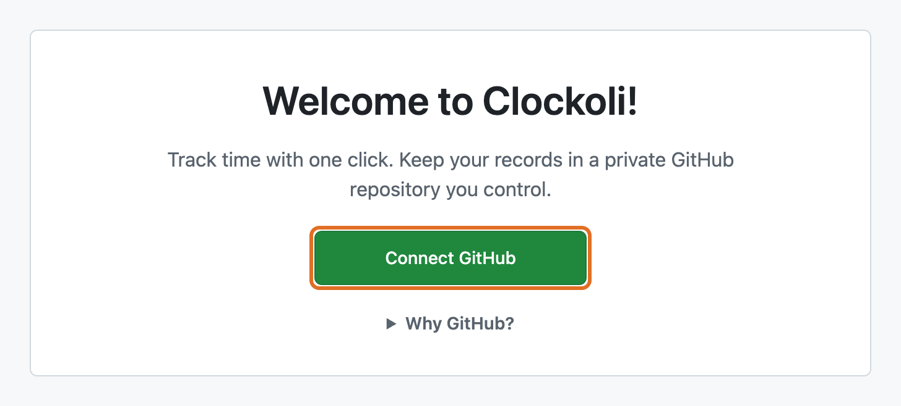
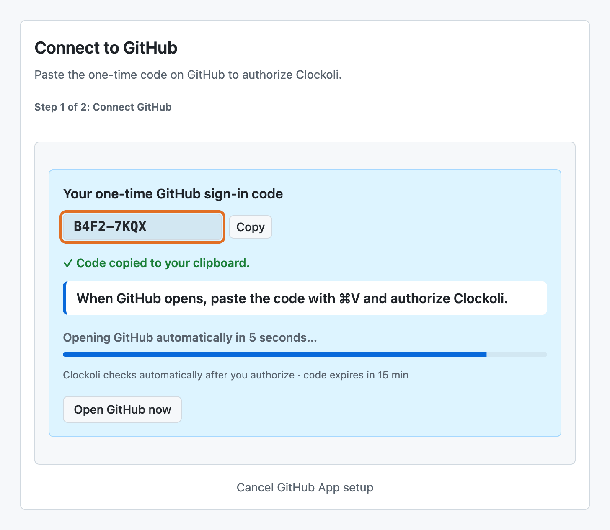
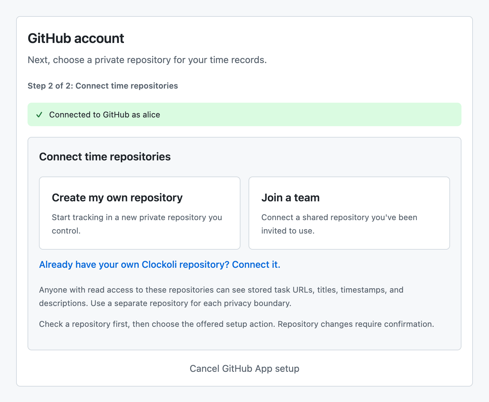

# Getting started

Connect GitHub, choose where your time is stored, and track your first task.

## Before you begin

You need a [supported browser](install.md#supported-browsers), a GitHub account, and a private GitHub repository you can write to (or permission to create one).

Clockoli calls the repository that stores your time a **time repository**. It can be different from the GitHub repositories and other websites you track. See [Key concepts](concepts.md).

The welcome screen opens after installation and guides you through two setup steps. Until setup is complete, clicking the Clockoli icon returns you to Settings instead of an empty Activity page.

## Step 1: Sign in with GitHub

1. Select **Connect GitHub**. If your browser asks for permission to contact GitHub, allow it.
2. Clockoli shows a one-time code and tries to copy it. If copying succeeds, GitHub opens after a five-second countdown. Select **Open GitHub now** to open it sooner.
3. On **github.com**, enter or paste the code and approve Clockoli.
4. Return to Clockoli. It detects the authorization automatically.

If copying fails, select **Copy**, then **Open GitHub to enter code**. If you closed GitHub's page, select **Reopen GitHub**.

GitHub sign-in and giving the Clockoli GitHub App access to your time repository are **separate permissions**. You may need to grant repository access in the next step.

## Step 2: Connect a time repository

Choose **Create my own repository** if you are setting up Clockoli for yourself, or **Join a team** if someone shared a time repository with you.

### Create your own repository

1. Select **Create a new time repository**. GitHub opens a template for a private repository, usually named `clockoli-data`.
2. Create the repository on GitHub, copy its URL, and return to Clockoli.
3. Paste the URL in Clockoli and select **Check repository**.

Creating a GitHub repository does **not** automatically give the Clockoli App access to it. Follow **Grant access** if prompted.

### Join an existing repository

1. Accept the GitHub repository invitation, if you received one.
2. Select **Join a team** and paste the repository URL or `owner/name`. You can also search for an accessible repository by typing at least two characters of its name.
3. Select **Check** or press Enter.

If you received a `clockoli.com/join/?repo=...` link, keep that page open during setup. Clockoli can detect it and preselect the repository. Older `#repo=` links also work. If detection fails, paste the invitation link manually. The link does not grant GitHub access by itself.

### Review and confirm

Clockoli checks that the repository is private, accessible, and suitable for storing time. If it shows **Grant access**, use GitHub's **Only select repositories** option and select the intended repository.

Then review the action Clockoli offers:

| Action | What it does |
|---|---|
| **Connect repository** | Adds an already prepared repository to this browser without changing GitHub files. |
| **Initialize repository** | Prepares a new repository for Clockoli. |
| **Join repository** | Registers you in an existing Clockoli repository and sets up your personal storage branch. |
| **Set up storage branch** | Prepares a missing personal branch. |

Only the last three actions write setup data to GitHub. Clockoli asks you to confirm them explicitly. Initializing an organization repository requires repository-admin permission.

The first successful connection completes initial setup and becomes the default repository. You can connect others later under **Settings → Time repositories**. For detailed permission and repository checks, see [Time repositories](time-data-repository.md#connect-a-repository).

**Privacy:** Anyone who can read a time repository can see the task URLs, titles, timestamps, and descriptions stored there. Use different repositories for groups that should not share that information.

## Track your first task

### From any website

1. Open an HTTP(S) page you want to track.
2. Select the Clockoli toolbar icon. Activity opens in a new tab (or focuses an existing Activity tab).
3. In **From current page**, select **Track this task**.
4. When you're done, add a description if useful and select **Stop and save**.

Clockoli uses the page URL as the task identity. Internal browser pages such as `chrome://extensions` cannot be tracked.

### From GitHub

On GitHub, select the Clockoli stopwatch before your avatar. It opens Activity with the current page ready to track. The icon also respects your chosen toolbar behavior.

To track without leaving the page, choose **Open quick popup** under **Settings → Toolbar button**. The popup lets you start or stop a task and open Activity in a tab.

Only one timer runs at a time. Starting a different task saves the previous one first. See [Track a task](tracking.md).

## Use a personal access token instead

If you cannot use the GitHub App, open **More settings → Advanced → Use a personal access token**. This compatibility option supports **one time repository**, not multi-repository routing.

Create a fine-grained GitHub token limited to that private repository with **Contents: Read and write**. Enter the repository owner, name, branch, and token, then select **Validate and use PAT**. Keep the token private; Clockoli does not show a stored token again.

## Next steps

- [Activity](activity.md) — browse your Timeline, Calendar, and List.
- [Add and edit time](editing-time.md) — fix or add completed entries.
- [Reports](reports.md) — filter and export time.
- [Work as a team](teams.md) — invite collaborators.
- [Settings](settings.md) — change preferences and back up local settings.
