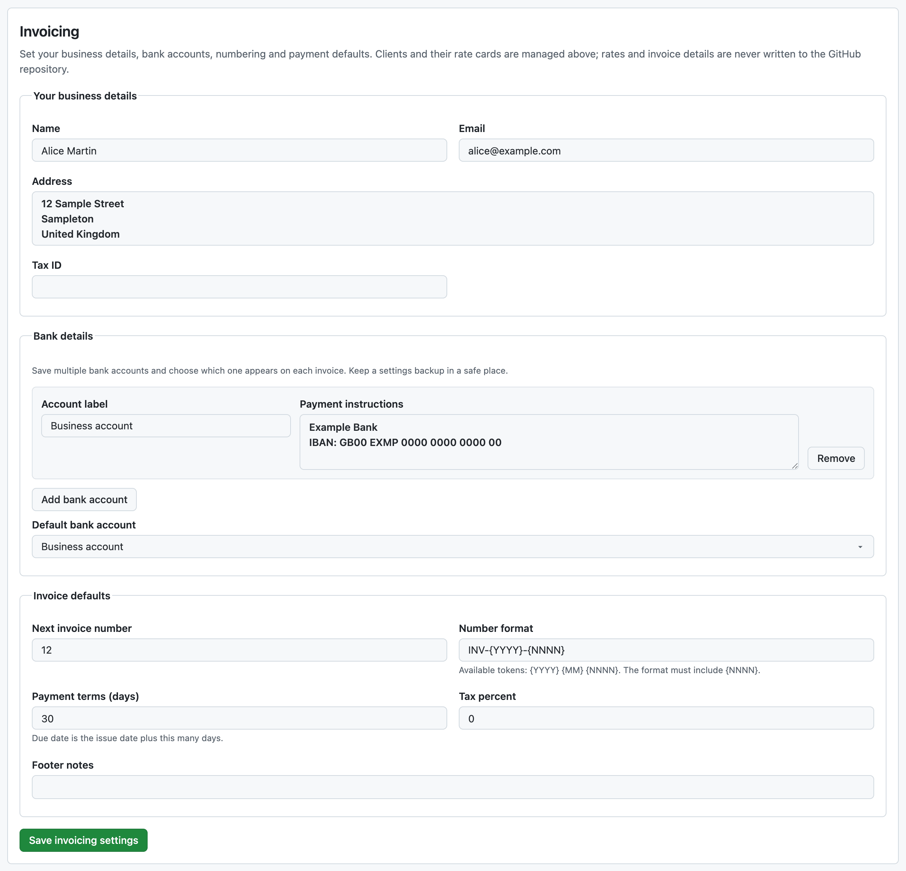
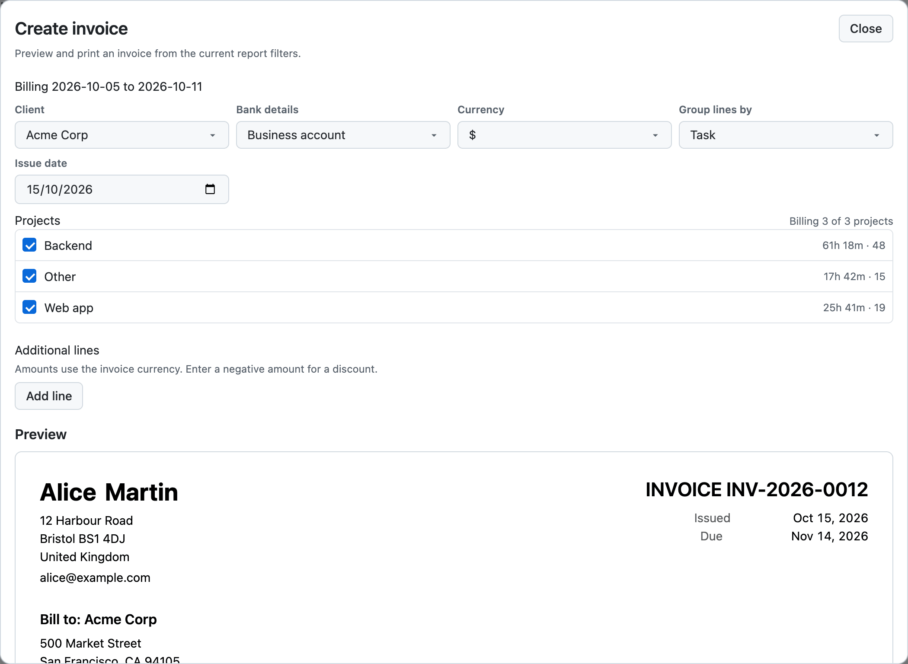
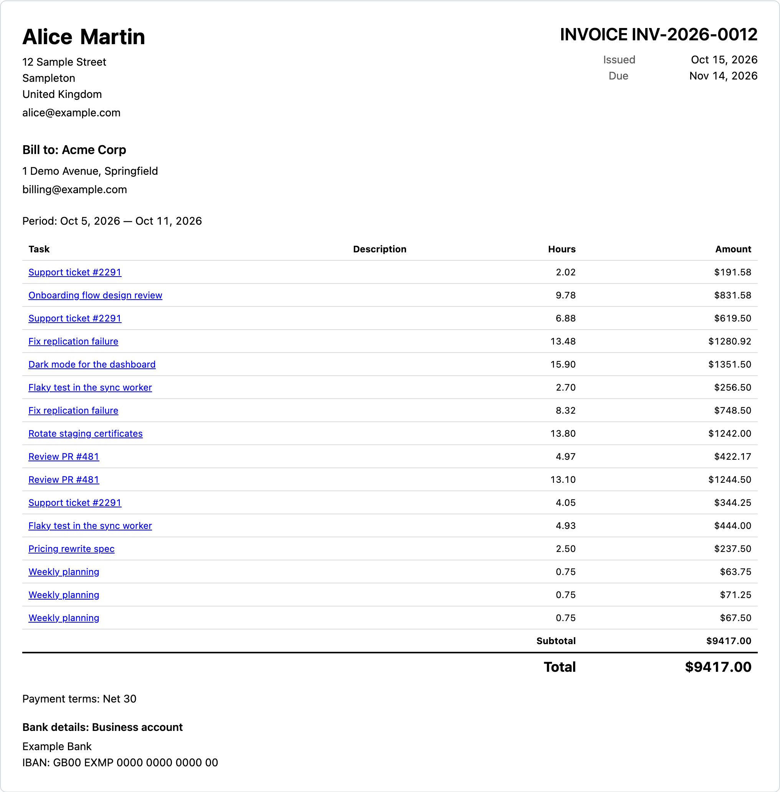

# Invoicing

Turn a filtered report into a numbered, taxed invoice, then print it or save it as PDF. Invoices never leave your browser.

Invoices are generated in the browser from your time records and local settings. No invoice, invoice number, rate, or client detail is ever written to the time repository.

## Set up invoicing

In **Settings**, use **Clients (invoice recipients)** to save each client, then use **Billable rates** to configure that client's rates. Keep **Add client**: one business or freelancer can invoice several clients. The separate **Invoicing** section holds **Your business details**, bank details, invoice numbering, payment terms, and tax defaults used for invoice previews. Select **Save invoicing settings**; success or an error appears beside the button. Invoicing needs [billable rates](billable-rates.md) **on the selected client** for the people you bill. Rates from other clients are never substituted.

Client details can be left empty when a client is used only for reports. Clients can own [projects](projects-and-routing.md).

Saving does not replace unexpected characters in names, addresses, bank details, or notes. If pasted text contains a tab or another unsupported control character, the error names the section and field (and bank account number where applicable), the character, and its position. Correct the draft and save again; ordinary spaces and line breaks in multiline fields are allowed.

### Bank details

Add up to 20 bank accounts under **Invoicing**. Give each an account label and payment instructions (for example, bank name, account holder, IBAN, SWIFT or routing details), then optionally choose a default. The default appears when you first open an invoice; the invoice dialog lets you choose a different saved account or **No bank details** for that invoice. Only the selected account's instructions appear in the preview and printed or saved invoice. Bank details stay in this browser and in any settings backup you download; they are not written to your time repository. Protect backups containing financial information.

### Payment terms

Payment terms (days) in Settings determines the due date from the issue date; zero means due on receipt.

Payment terms can range from 0 to 365 days. The **Footer notes** field supports line breaks.

## Create an invoice

1. Open **Reports** and filter it: the selected period, people, projects, and sources define what is billed.
2. Choose **Create invoice**.
3. Choose a client, bank details (if needed), currency, and whether to group lines by task or by day and task, review the preview, then choose **Print** or **Save as PDF**.

Each invoice uses one target currency. When effective-dated rates change within the period, Clockoli keeps the corresponding invoice lines separate; when the covered records use multiple currencies, it converts each entry using the exchange rate for that entry's date. Unrated time remains visible as not billed.

The invoice dialog shows the billing period from the Reports Start and End dates. To bill another period, change the period in Reports first.

Picking a client narrows the invoice to that client's work without changing the report filters, and selects the client's local rate card. Clockoli warns when an invoice also includes projects owned by another client.

A partial report can still produce an invoice preview when rated entries are available. However, **Print** and **Save as PDF** remain disabled until the report is complete, so missing time repositories or omitted conflicts cannot cause an incomplete invoice to be issued.

## Additional lines

Add up to 20 additional lines for charges or discounts in the invoice currency. An unfinished line is kept as a draft: the invoice preview continues to show completed lines, and printing or saving remains unavailable until all additional lines are completed or removed. These amounts are included in the subtotal and taxed, without exchange-rate conversion. In an additional line's Description, **Shift+Enter** inserts a newline and **Enter** applies the text to the live invoice preview, showing **✓ Applied**; this is a preview change, not a saved invoice. Actual invoice output is created with **Print** or **Save as PDF**.

## Invoice numbers

Invoice numbers are reserved only on the first **Print** or **Save as PDF** action for a preview and are never committed to the time-data repository. The counter only moves forward: saving or importing settings cannot lower it below a number that has already been issued.

## Where invoices live

An invoice exists only as the on-screen preview and as a file you print or download. Clockoli does not archive invoices. CSV and JSON timesheets remain available on Reports when the report is complete. See [Invoice privacy](data-and-privacy.md#invoice-privacy).

## Limits

Clockoli does not support retainers, recurring invoices, reminders, payment links, tracked-time line editing, sent or paid status, an invoice archive, or emailing invoices.
