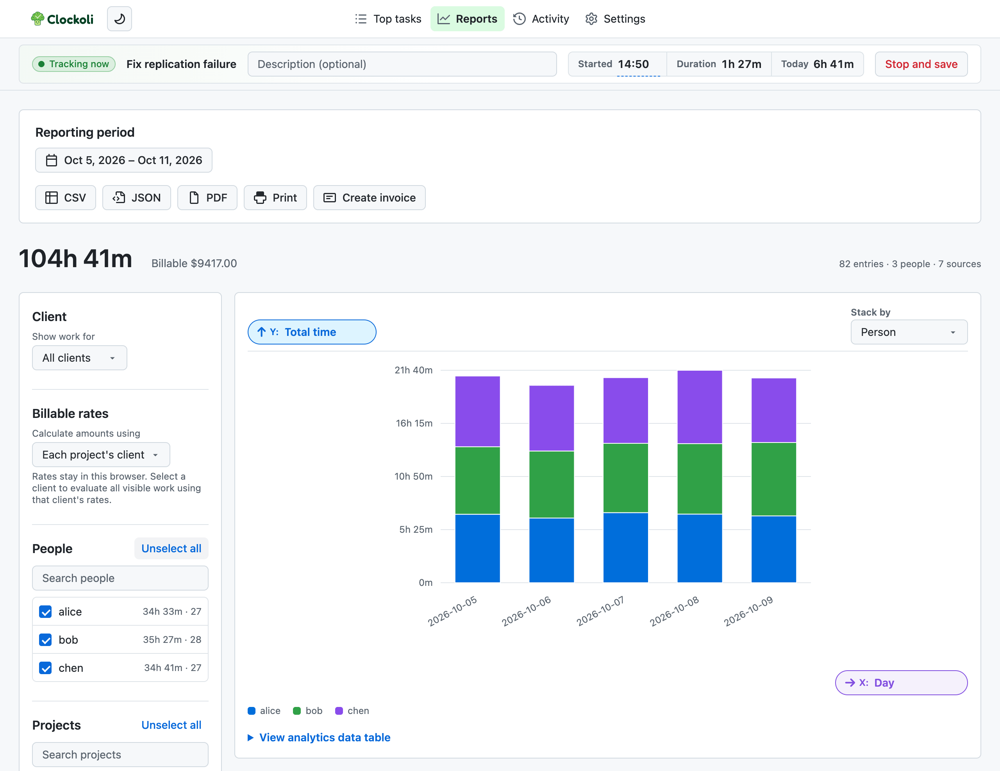
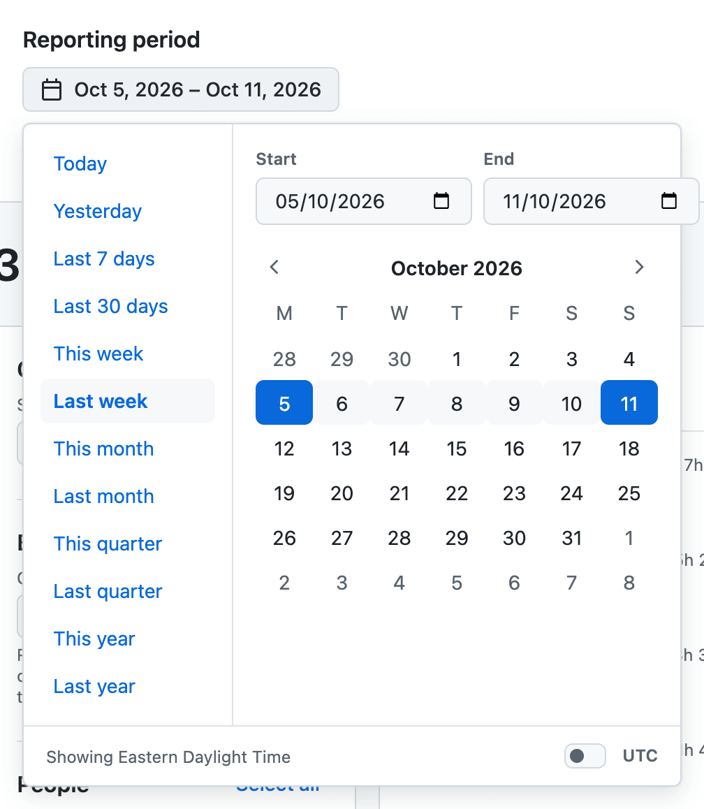

# Reports

Filter tracked time, explore charts, export timesheets, and create invoices across the repositories you can read.

Reports includes an entry when its **Start date** falls within the selected period.

## Choose a period

Select the date-range button to choose **Today**, **Yesterday**, the last 7 or 30 days, this or last week, month, quarter, or year, or a custom Start and End date.

Presets apply immediately. For a custom range, select the first and last days or enter dates directly. The range is inclusive.

A large period can exceed Clockoli's safe GitHub read limits. If prompted, choose a shorter range.

## Local dates or UTC

By default, Reports uses each entry's recorded local Start date. Enable **UTC** to group and filter by UTC Start date instead.

The chosen basis also affects rate dates, exchange-rate dates, timesheet exports, and invoices. Clockoli saves this preference locally.

## Filter a report

Filter by **Client**, **People**, **Projects**, **Sources**, and **Time repositories**.

A **Source** is where the tracked task lives: the GitHub `owner/repository` for an issue or pull request, or the hostname for another website. A **Time repository** is where its record is stored.

The summary shows total tracked time, billable amount, entries, people, and sources.

## Explore charts

The controls beside the axes show what you are measuring:

- **Y:** Total time, Avg time per distinct task, Billable amount, or Task count.
- **X:** Group by day, week, month, person, source, time repository, or task.
- **Stack by:** Split the bars using a separate grouping.

Use **View analytics data table** to inspect the underlying chart values.

To calculate money, set up [billable rates](billable-rates.md). Under **Calculate amounts using**, select one client's rates for all visible work or **Each project's client** to apply rates by project. There is no global rate fallback.

When amounts span several currencies, Reports lets you choose a chart currency and converts by the relevant dates. Only currency codes and dates are sent to [Frankfurter](https://frankfurter.dev/).

## Export a timesheet

- **CSV** or **JSON:** download individual time entries, including task, person, Start, End, duration, and description. Local rate and amount fields are included when available.
- **PDF:** download a timesheet.
- **Print:** open the browser's print dialog.

Exports use the currently loaded report, filters, and local rate settings. Reload the report after changing source data or billing settings.

For a client invoice, select **Create invoice** and follow [Invoicing](invoicing.md).

## Loading, partial data, and pending changes

Reports may show a cached result while it refreshes from GitHub. Cached totals can be out of date, so exports and invoice output stay unavailable until Clockoli has verified fresh data.

If a repository cannot be read or conflicting duplicate records are found, Reports marks the result **partial** and disables timesheet exports. You may still be able to preview an invoice, but printing or saving it requires complete data.

Reports reads GitHub records, not changes still queued in this browser. If synchronization is pending, final exports and invoice output remain blocked until the changes are verified. Review conflicts in **Activity → Review sync issues**, then reload Reports.

For sync behavior, see [Sync and offline work](sync.md).
