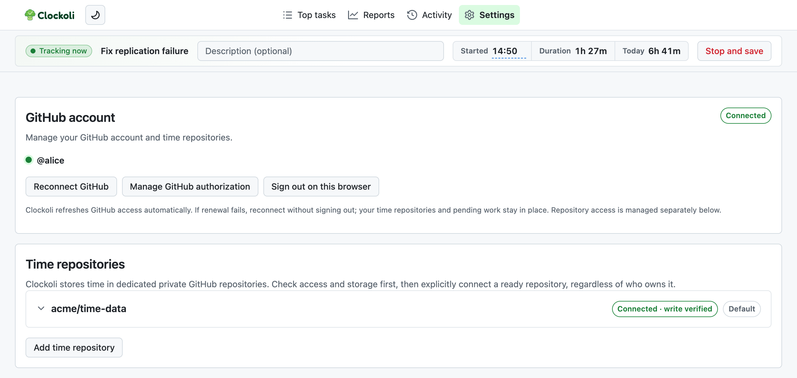
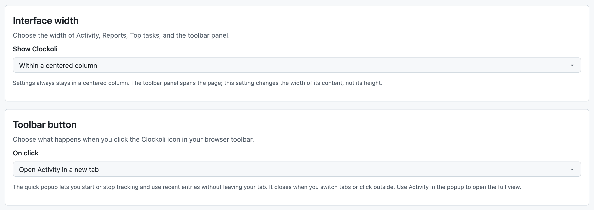
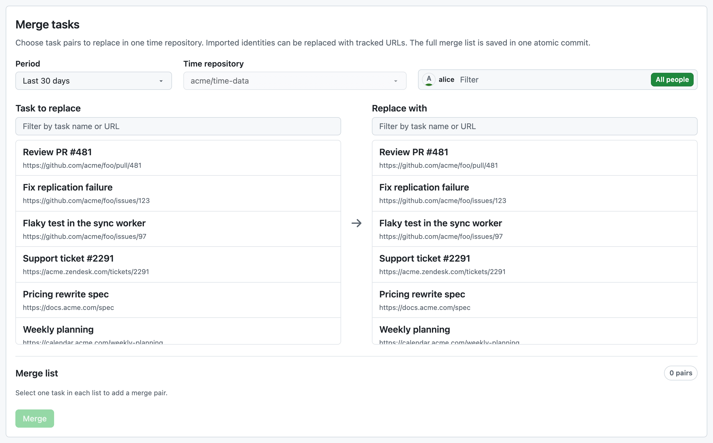
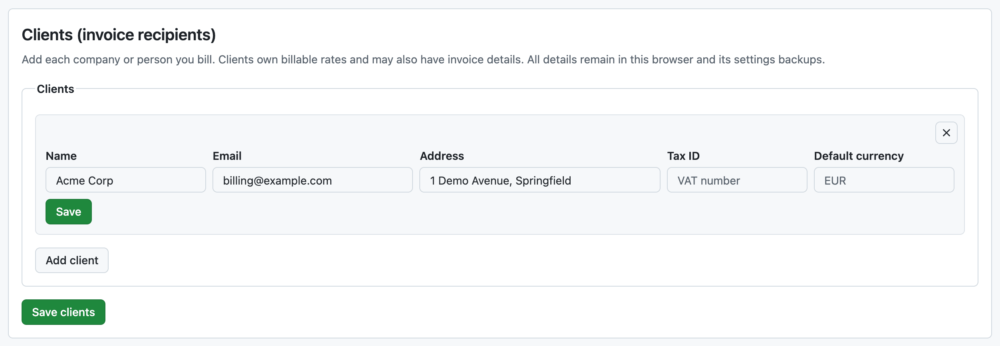
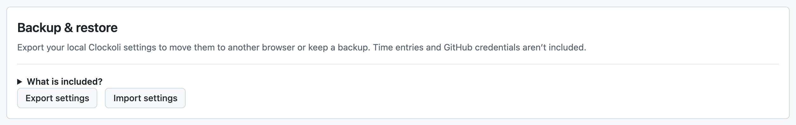

# Settings

Settings controls your GitHub connection, time repositories, interface, project routing, billing preferences, and local backups.

The welcome screen appears until you connect your first time repository. Once setup is complete, open **Settings** from Clockoli's page navigation.

## GitHub account

Use this section to sign in, renew your connection, or **Sign out on this browser**.

Signing out removes local credentials but does not revoke GitHub authorization, uninstall the Clockoli App, or delete time in your repository. If a running timer or queued write would be put at risk, Clockoli blocks unsafe account changes.

For initial setup, see [Getting started](getting-started.md).

## Time repositories

Each connected repository offers **Check access**, **Open repository**, **Manage GitHub access**, **Make default**, and **Disconnect repository**.

Disconnecting affects this browser only. It does not delete GitHub data or change another teammate's access. You cannot disconnect while it would strand running or unsynced work.

Select **Add time repository** to connect another destination. Repository cards also show collaborator and invitation controls when you have the required permissions.

See [Time repositories](time-data-repository.md) and [Work as a team](teams.md).

## Interface width

Choose a centered layout or use the available screen width for Activity, Reports, and Top tasks. This preference stays in the current browser and is not included in settings backups.

## Toolbar button

Choose what happens when you select the extension's toolbar icon or the Clockoli stopwatch on GitHub:

- **Open Activity in a new tab** (default): opens or focuses Activity and passes the current page's task URL.
- **Open quick popup**: shows a small tracker with the current timer, description, recent entries, **Stop and save**, and **Open Activity in a new tab**.

The popup has no Timeline, Calendar, or List controls. **Open Activity in a new tab** remains visible even when entries scroll. On GitHub, opening a popup requires Chrome 127+; other supported versions fall back to Activity.

The choice stays in this browser. Until initial setup is complete, Clockoli sends you back to Settings or offers **Set up Clockoli**.

## Projects and routing

Choose a default time repository and optional client for unmatched URLs, and create ordered project rules for other destinations. See [Projects and routing](projects-and-routing.md).

### Activity display

**Recent entries shown in the main panel (days)** accepts 1–31 days (default 7). It only affects the recent-entry display, not the full Activity, Top tasks, or Reports history. Save it with **Save projects and routing**.

## Merge tasks

Use **Merge tasks** to combine records tracked under two task identities, such as a Clockify import and its GitHub issue.

1. Choose the **Period**, **Time repository**, and **People**. Select **All time** if older entries are involved.
2. Choose a **Task to replace**.
3. Choose an existing HTTP(S) task in **Replace with**.
4. Review the **Merge list** and select **Merge**.

Merge updates the selected records in one Git operation. It is not part of the ordinary background sync queue.

## Add-ons

Enable packaged integrations, including [Clockify migration](add-ons.md), and review their optional permissions before enabling them.

## More settings

During onboarding, these sections appear under **More settings**. After setup, they are available on the Settings page.

### Clients (invoice recipients)

Create clients for reports, rate cards, and invoices. Billing contact details are optional if you only need reports.

### Billable rates

Each rate belongs to a client and can have effective dates. Rates stay local to this browser. See [Billable rates](billable-rates.md).

### Invoicing

Configure your business details, payment accounts, invoice numbering, due dates, taxes, and notes. See [Invoicing](invoicing.md).

### Backup & restore

**Export settings** downloads a JSON backup of local preferences, project routing, client records, billable rates, invoicing details, and credential-free repository references.

Backups **exclude** GitHub credentials, active timers, pending writes, time records, and caches. Activity view, interface width, and toolbar behavior are also browser-specific rather than included in the backup.

**Import settings** validates the file and restores supported settings. Repository routes can be restored only for destinations already connected in this browser; import does not connect GitHub, verify access, add repositories, or replace the current default automatically.

Backups may contain confidential client, rate, and bank details. Store them securely, and export a new backup when you change those settings.

See [Settings backup exclusions](data-and-privacy.md#settings-backup-exclusions).

### Advanced

#### Diagnostics

**Show queue diagnostics in the tracking panel** displays a local operation log for investigating sync issues. Leave it disabled unless you are troubleshooting.

#### Use a personal access token

A single-repository alternative if the GitHub App cannot be used. See [PAT setup](getting-started.md#use-a-personal-access-token-instead).

#### Recovery and access

- **Clear all local Clockoli data** removes local settings, credentials, and **unsynced work** from this browser. Stop timers and verify synchronization first.
- **Revoke GitHub sign-in** opens GitHub settings to revoke Clockoli's user authorization. It does not uninstall the GitHub App or delete repository records.

## Appearance

Use the sun/moon control on Clockoli pages to switch between light and dark themes. The choice stays local and is shared across the extension's pages and popup.
