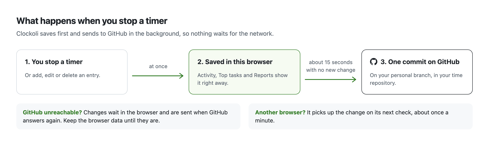

# Sync and offline work

Clockoli saves accepted time changes in your browser first, then sends them to GitHub automatically. You can keep tracking during a temporary GitHub outage.

## When changes sync

Starts, Stops, switches, added time, edits, and deletions enter a durable local queue. Clockoli normally pushes them **about 15 seconds after your last change**. Each new change restarts that quiet period. There is no manual Sync button.

Browser background workers can be suspended. Clockoli uses background alarms to retry, but an update may take longer than 15 seconds, especially if the browser is closed or GitHub is unavailable.

Clockoli also checks for changes from other browsers at startup and approximately once per minute. Full history and teammates' records are loaded as needed.

## What you see while offline

Locally accepted edits, stopped timers, and new entries appear in Activity immediately and survive page reloads. They stay queued until GitHub accepts them.

Ordinary pending changes do not show a distracting sync spinner. If something needs attention, the **Activity** tab shows an issue indicator and Activity offers **Review sync issues**.

**Do not uninstall Clockoli, clear its browser data, or sign out as a way to fix a pending write.** You could lose changes that have not reached GitHub.

## Reports and exports

Reports reads committed GitHub records, not pending edits from this browser. If changes are still queued, Reports warns that its totals may be incomplete and blocks exports or invoice output when it cannot verify that the data is current.

When a repository cannot be read, Reports may show a partial result, but exports remain disabled until the required data is complete.

## Conflicts and recovery

Clockoli checks file versions, stable record IDs, neighboring time intervals, and the active timer to avoid overwriting other work.

When a remote change conflicts with a queued edit, Clockoli keeps the local operation and asks you to review it. Independent writes may continue, while dependent Starts, Stops, or edits can wait.

To recover:

1. Open **Activity → Review sync issues**.
2. Compare the local change with the saved GitHub entry or timer.
3. Use the offered **Retry**, correction, or verified discard action. Confirm the time exists elsewhere before discarding it.

A cross-repository switch saves the original timer's completion before starting the next one remotely. If the completion conflicts, the dependent Start may have to wait.

For common problems, see [Troubleshooting](troubleshooting.md#synchronization-and-conflicts). For queued additions and complex overlapping timer recovery, see [Advanced sync recovery](sync-recovery.md).
