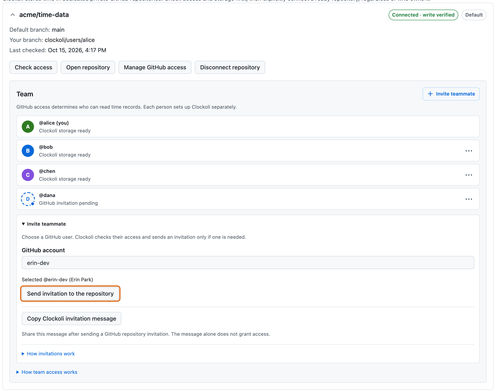
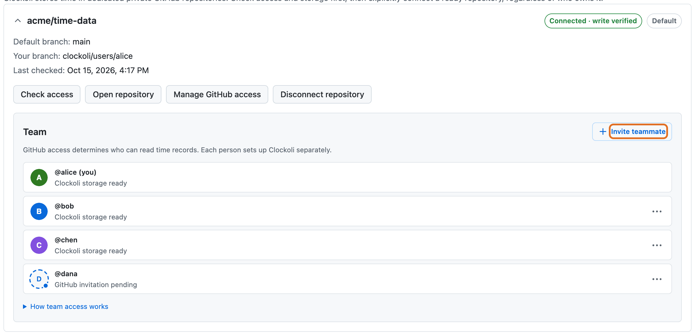

# Work as a team

Share one private time repository with your team, invite and remove teammates, and report on everyone's time together.

Teammates track into the same repository, each on a personal branch, and Reports reads everyone's branches as one view. There is no Clockoli workspace or admin role: GitHub repository access decides who can read and write.

## Before you start

Repository readers can see every stored URL, title, timestamp, and description included in shared reporting. Use separate time repositories for groups with different access boundaries.

Initializing an organization repository requires GitHub repository-admin permission; Clockoli does not create a permanent Clockoli admin role. An ordinary employee cannot use the join flow to initialize an unmarked organization repository. Repository discovery and inspection never write a marker, branch, membership, or work record.

## Set up a shared repository

1. A repository administrator signs in, chooses a dedicated private time repository from autocomplete or enters its URL, and grants the Clockoli GitHub App access only if needed. The repository may belong to a person or an organization.
2. If the repository is not initialized, the administrator checks it, reviews the privacy disclosure, and explicitly confirms **Initialize repository**.
3. The administrator gives each teammate GitHub write access to the repository, either through **Invite teammate** in Settings (below) or directly on GitHub.
4. The teammate opens a Clockoli invitation URL such as `https://clockoli.com/join/?repo=acme%2Ftime-data`, keeps that tab open, installs Clockoli and signs in to GitHub. The extension discovers the invitation and prepares **Join a team** with the exact repository. With several invitation tabs, the teammate chooses one. If automatic pickup is unavailable, they can paste the full invitation link or the GitHub repository URL manually.
5. The teammate accepts any pending GitHub repository invitation. If Clockoli App access is missing, the repository administrator must grant the App Contents write access. Clockoli checks access again before offering a join action.
6. After reviewing the disclosure, the teammate explicitly confirms **Connect repository** if storage is already ready, **Join repository** for a new member, or **Set up storage branch** if they are already a member with a missing branch.
7. Clockoli creates and verifies each user's personal storage branch, named from their stable GitHub user ID.
8. Teammates can add the shared repository alongside other personal or organization time repositories and [route projects](projects-and-routing.md) to it.

Give reporting-only users read access only if they may inspect all stored work data in that repository.

## Invite teammates

In **Settings → Time repositories**, find the connected repository and select **Invite teammate**. Clockoli verifies your GitHub repository-admin rights and the App's Administration: write permission *before* opening the user search. If either is missing, the reason appears in the repository card; **Manage GitHub access** opens the relevant GitHub settings.

Search a GitHub username, choose the verified account (login, public display name and avatar), and select **Send invitation to the repository**. Clockoli confirms which private time repository will grant write access and warns that collaborators can read each other's stored time. It then checks the selected GitHub user ID, repository identity, current access and pending invitations, and sends a GitHub invitation only when needed. Existing write access and pending invitations do not result in duplicates. Read-only access must be upgraded in GitHub.

The invitation uses GitHub's repository permission system. A teammate must accept on GitHub and separately join Clockoli. **Copy Clockoli invitation message** copies a ready-to-send message with the repository name, `clockoli.com/join/?repo=...` setup link, and instructions to keep the join page open while installing Clockoli. Share it after sending the GitHub invitation; the message itself does not grant repository access. Older `#repo=` links are still accepted. **How invitations work** explains the process without another copy action.

Inviting requires both the signed-in user's repository-admin rights and **Administration: Read and write** on the Clockoli GitHub App installation. The App owner must enable that permission and installations must accept the updated permission request. Choose **Only select repositories** and grant the App access to the intended time repository: App permissions apply to the repositories selected for that installation, not automatically to the entire GitHub account. Organization and enterprise policies can forbid outside collaborators.

## View the team

Each connected repository has a **Team** section. The list initially shows up to four GitHub collaborators and four pending GitHub account invitations. **More collaborators** and **More pending invitations** expand the additional verified accounts directly in Settings. When the GitHub API page is incomplete, the expanded section links to GitHub for the remaining accounts. Each account has a labeled state:

- **GitHub invitation pending** — GitHub has not yet confirmed access.
- **GitHub access granted** — GitHub permits access, but Clockoli storage readiness has not been verified.
- **Clockoli storage ready** — a registered stable GitHub ID has a matching personal branch with valid ownership metadata and a valid task index. This confirms storage preparation, not extension installation or recent activity.

This distinction matters: GitHub repository access is not the same as joining Clockoli. If a storage check is inconclusive, Clockoli keeps the GitHub-access state instead of claiming the user has joined. Email-only invitations have no GitHub account avatar and are not shown; the pending lookup scans up to five pages. A failed collaborator read shows “Collaborators unavailable”.

## Remove access

For each other person's row in **Team**, select the **⋯** menu and choose **Remove @user**, or **Cancel invitation for @user** for a pending invitation. Your own account has no removal action.

Clockoli asks for confirmation, checks repository identity, administrator permissions, account ID and current access, then uses GitHub to remove the collaborator or cancel the invitation. Feedback appears inside **Team**, next to the member list, including permission errors. After GitHub accepts a removal, Clockoli refreshes the list: if the person still appears, it explains that their access may come from an organization or GitHub team (or the change may still be propagating) and directs the administrator to **Manage GitHub access**. Removing access does **not** delete existing time records or Git history.

The Team section initially displays four accounts in each category; expand **More collaborators** or **More pending invitations** to see the additional verified accounts available from GitHub. Use **Manage GitHub access** for other accounts and email-only invitations. Changes require a GitHub App connection with Administration write permission and repository-admin rights. PAT connections allow viewing verified repository collaborators, but do not expose invitation or removal controls.

## Report across the team

[Reports](reports.md) combines the selected visible repositories and every valid personal branch in them. On GitHub issue and pull-request pages, the stopwatch dialog can show **Tracked on this issue/PR** totals for all participants. Hourly rates stay in each browser, so teammates sharing a repository can use different rate cards.
