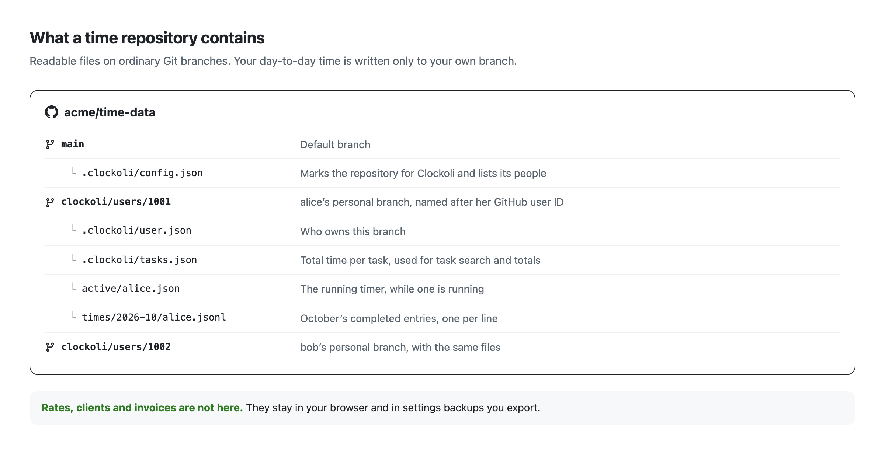

# Time repositories

A **time repository** is a private GitHub repository where Clockoli stores your timers and completed entries. It can be different from the **source repository** whose issues or pull requests you track.

You can connect several time repositories and choose a default. [Projects and routing](projects-and-routing.md) decides where each new task is saved.

## Requirements

A time repository must:

- be **private**, not archived or disabled;
- give your GitHub account read/write access;
- give the Clockoli GitHub App **Contents: Read and write** access;
- allow Clockoli's direct writes under its branch rules;
- be empty or contain valid Clockoli storage data.

When granting App access, prefer **Only select repositories**. Organization-owned repositories may need administrator approval. Initializing an organization repository requires repository-admin permission.

## Connect a repository

[Getting started](getting-started.md#step-2-connect-a-time-repository) covers your first connection. To add another, open **Settings → Time repositories** and select **Add time repository**.

1. Choose **Create my own repository** or **Join a team**.
2. Paste the repository URL, `owner/name`, or a Clockoli invitation link. You can also type at least two characters to search accessible repositories.
3. Select **Check** (or press Enter). The check reads repository state but does not connect or change it.
4. If needed, select **Grant access** and choose the intended repository in the GitHub App installation.
5. Review the action Clockoli offers and confirm it.

| Action | Result |
|---|---|
| **Connect repository** | Connects a ready repository in this browser without writing GitHub files. |
| **Initialize repository** | Prepares an empty or otherwise eligible repository for Clockoli storage. |
| **Join repository** | Registers your GitHub identity in an initialized repository and prepares your storage branch. |
| **Set up storage branch** | Prepares or verifies your missing personal branch. |

Clockoli confirms writes explicitly and checks permissions again before applying them. A repository labeled **Ready — not connected** still needs **Connect repository**.

Creating a GitHub repository does not automatically grant the Clockoli App access to it. If **Grant access** does not work, ask the repository or organization administrator to approve the App's Contents-write permission.

The first connected repository becomes your default. Adding others does not change it; use **Make default** or the default selector to switch destinations. Changing the default affects **future** timers, not running or queued work.

### If a check fails

Check the exact owner/name, your GitHub permissions, the App grant, private visibility, and branch rules. An unavailable private repository may simply be hidden by GitHub's permissions.

Clockoli does not replace an unavailable target with a different repository or adopt a branch with unknown ownership. If it reports incompatible existing files, inspect them rather than deleting them to bypass validation.

For team setup and invitations, see [Work as a team](teams.md).

## Manage connected repositories

In **Settings → Time repositories**, each connected repository provides:

- **Check access:** verify permissions and storage.
- **Open repository:** open it on GitHub.
- **Manage GitHub access:** change the GitHub App's repository grant.
- **Make default:** use it for unmatched tasks.
- **Disconnect repository:** remove this browser's Clockoli connection.

**Disconnect repository** does not delete the GitHub repository, its records, its history, or another teammate's connection. Clockoli blocks disconnection if running or queued work would be stranded.

For multiple destinations, use GitHub App sign-in. The advanced PAT option supports one time repository only.

## Branch and storage layout



The default branch contains the shared repository marker:

```text
.clockoli/config.json
```

Each person writes to a personal branch named from their **stable numeric GitHub user ID**:

```text
clockoli/users/{github-user-id}
```

That branch contains:

```text
.clockoli/user.json
.clockoli/tasks.json
active/{storage-login}.json
times/{YYYY-MM}/{storage-login}.jsonl
```

- `.clockoli/user.json` records ownership of the personal branch.
- `active/` stores a running timer.
- `times/` stores completed records in monthly JSON Lines files.
- `.clockoli/tasks.json` is the task index used for efficient task lookup and totals.

Routine time writes stay on personal branches rather than the default branch. This reduces conflicts between teammates.

## Data format v1

Completed records use `schema_version: 1`, stable record IDs, UTC timestamps, a local date and time zone, task identity, actor, producer, and optional description or metadata. A running timer retains its ID when completed.

The [Data format v1](data-format-v1.md) specification is the authoritative reference for fields, validation, and storage rules. Do not infer the schema from one example or change files without following that contract.

## Validation and manual editing

You can inspect and back up repository files with ordinary Git tools, but editing them outside Clockoli bypasses UI checks.

If you edit files manually:

- preserve record IDs, `schema_version`, and required fields;
- keep one valid JSON record per line in monthly JSONL, without blank lines;
- keep UTC timestamps and valid IANA time zones;
- keep each record's local date in its correct monthly file;
- update the task index consistently with completed-record changes;
- preserve unknown fields and avoid duplicates.

Malformed records or inconsistent task indexes are rejected rather than silently skipped. Use [Data format v1](data-format-v1.md) and Git history for recovery. For an independent backup, you can use `git clone --mirror`.

## Access and privacy

Anyone with read access to a time repository can inspect stored task URLs, titles, timestamps, descriptions, and Git history. Use separate repositories for groups with different access requirements.

A source repository does not receive time entries or need Clockoli write access just because you track an issue from it. Local hourly rates and invoices are never stored in the time repository.

See [Data, privacy, and security](data-and-privacy.md) for access boundaries and [Sync and offline work](sync.md) for what happens when writes are delayed.
