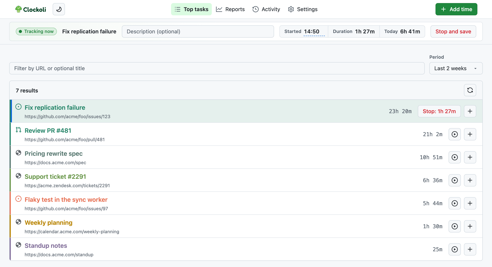

# Top tasks

See the tasks you tracked recently with their total time, and pick any of them up again with one click.

Open **Top tasks** from the tabs at the top of Activity, Reports, and Settings.

## What the list shows

Top tasks aggregates the current user's completed and running sessions by canonical task identity across selected time repositories.

- Without a filter, the list and tracked-time totals show only your own work, including imported non-URL identities. Typing a title or URL finds only tasks whose identities are HTTP(S) URLs, including completed tasks tracked by people in the connected time repositories outside the selected period. A teammate-only result shows **—** instead of attributing their hours to you.
- Periods: last 2 weeks, month, 3 months, 6 months, or year. The list includes entries whose Start date falls in the selected period.
- Completed and running time participate in ordering.
- The task identity appears as a compact source line, with the optional title as the prominent link below it. Untitled URL tasks show the URL as the primary link without duplication. Imported tasks without a navigable URL show a non-link identity and title.
- URL tasks aggregate across destinations with sorted time-repository provenance. Imported non-URL identities remain separate per destination, even if their text matches; when multiple repositories are connected, their rows show the time repository so identical identities can be distinguished.

Cross-user suggestions require an HTTP(S) URL identity and a nonempty task title. Untitled or imported non-URL tasks remain in personal records and the unfiltered list. Search uses a local catalog built from each person's Git-backed task index. Matches return without GitHub; misses against a complete catalog updated within the last minute also return locally, while older misses refresh changed personal branches. See [Search for a task](editing-time.md#search-for-a-task) for refresh and partial-result behavior.

## Start a task again

Each task, including unresolved Clockify imports with a bare `owner/project/task-slug` identity, shows accumulated time, a play-icon **Start** control (or **Stop** with the elapsed time for the running task), and a plus-icon **Add time** control. Starting another task stops the running timer first and keeps the imported identity unchanged. **Add time** opens the shared form with that row's task selected, including its time repository for imported identities; it does not stop a running timer merely by opening the form. Page-originated starts and manually entered new tasks still require HTTP(S) URLs.

Use **Add time** next to the page tabs to add a completed entry or start a timer for any task; see [Add a single entry](editing-time.md#add-a-single-entry).

## Loading and titles

The page reads the current user's monthly paths from the selected destinations before hydrating optional GitHub issue/PR titles. Destinations load independently, so available tasks may remain visible with partial-read status. Metadata is bounded and cached; inaccessible metadata falls back to the stored URL/title rather than hiding tracked time.

For a previously loaded period, the last local task list appears while a fresh read runs; the Refresh icon indicates progress. You can search or start a cached task without waiting for the list refresh. Its totals may be outdated until the read finishes; a failure leaves the previous list and an error visible. The current running timer and pending-write status are read from local tracking state, not trusted from an old task snapshot.

If your own task is missing from the unfiltered list, check the selected period. Search can find older and teammate tasks, but Top tasks shows only your own time; use [Reports](reports.md) for teammates' time.
