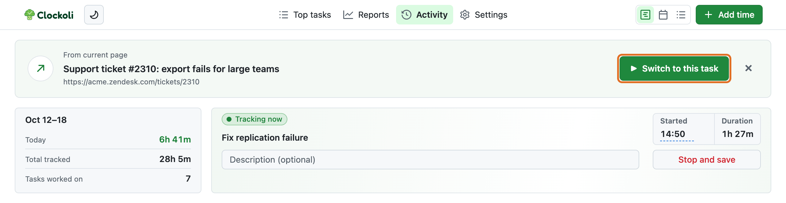

# Track a task

Clockoli tracks work against a task's URL. Start from any HTTP(S) page, or use the Clockoli stopwatch on GitHub.

## Start and stop a timer

1. Open the page you want to track.
2. Select the Clockoli toolbar icon. By default, it opens or focuses the **Activity** tab.
3. In **From current page**, select **Track this task**. If another task is running, select **Switch to this task**.
4. When you finish, optionally add a description and select **Stop and save**.

A task's canonical URL identifies it; its title is optional. GitHub issue and pull-request notification parameters are removed so links to the same issue stay one task. Other websites keep their query strings because they may identify different pages. GitHub Projects issue panes use the underlying issue URL when available. Internal browser pages are not trackable tasks.

The toolbar button only passes the selected page's URL and title to Clockoli. It does not add tracking controls over that page. You can dismiss **From current page** without stopping a timer.

## Use the quick popup

In **Settings → Toolbar button**, select **Open quick popup**. The toolbar icon and GitHub stopwatch then open a small tracker instead of Activity, where supported.

The popup lets you start or switch to the current page, edit the running description, **Stop and save**, restart recent tasks, and **Open Activity in a new tab**. It does not include Timeline, Calendar, or List controls.

Opening the popup from a GitHub page requires Chrome 127 or newer; other supported versions fall back to Activity. See [Settings](settings.md#toolbar-button).

## One timer at a time

Only one timer can run for your GitHub account across connected time repositories and browsers. Starting another task saves the running one first.

On a switch between time repositories, Clockoli preserves the original destination for the stopped timer and starts the next timer in the repository chosen by [project routing](projects-and-routing.md). Changes are saved locally and synchronized with GitHub in the background.

To restart a task, select **Start** in [Top tasks](top-tasks.md), use a List row's tracking control, or select **Track again** on a completed Timeline or Calendar entry. A completed entry cannot stop another running interval, even if both belong to the same task.

Clockoli asks for confirmation before stopping a timer longer than **12 hours**, in case you forgot it was running.

## Descriptions

Descriptions are optional and can contain multiple lines, up to 2,000 characters.

- **Enter** saves a description without stopping the timer.
- **Shift+Enter** inserts a new line.
- **Escape** cancels an unsaved inline edit, where available.

Quick start on Clockoli pages offers recently tracked tasks. If the latest entry has a description, starting the task again selects that text so you can reuse or replace it.

## Change the running start

To correct the time without changing the date, select the **Started** field in the running tracker. Type a time such as `1000` for `10:00`, then press Enter or select the checkmark.

To change the date as well, open the running entry in Activity's Timeline or Calendar and select **Edit**. Clockoli checks for overlaps before accepting the change. See [Add and edit time](editing-time.md#edit-a-running-timers-start).

## When GitHub is unavailable

Clockoli saves timer changes in your browser first, then syncs them to GitHub automatically. Your local timer remains visible while GitHub is offline or rate-limited. Do not clear extension data while changes are waiting to sync.

See [Sync and offline work](sync.md) and [Troubleshooting](troubleshooting.md) for recovery steps.
